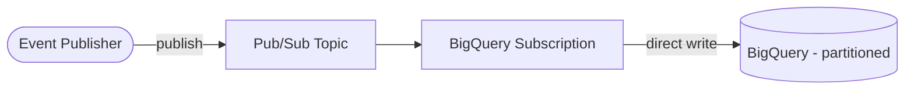

# GCP Streaming Data Warehouse (Terraform)

> Real-time analytics on Google Cloud: Pub/Sub streams straight into a partitioned BigQuery table via a BigQuery subscription — no Dataflow required.
> **Author:** Muhammad Ahmad · **IaC:** Terraform · **Cloud:** GCP


---

## 📌 Overview

- A **Pub/Sub topic** receives event messages.
- A **BigQuery subscription** writes messages directly into a **partitioned BigQuery table** (`ts` day-partitioned) — Google manages the streaming, so there is no Dataflow job to run.
- The Pub/Sub service account is granted **BigQuery Data Editor** on the dataset.

## 🏗️ Architecture



## 🚀 Deploy & test

```bash
cd terraform
gcloud auth application-default login
terraform init
terraform apply -var="project_id=YOUR_PROJECT_ID"

# Stream an event straight into BigQuery
gcloud pubsub topics publish $(terraform output -raw pubsub_topic) \
  --message='{"id":"1","event":"purchase","value":42.0,"ts":"2026-10-20T10:00:00Z"}'
```

## 🧹 Clean up

```bash
terraform destroy -var="project_id=YOUR_PROJECT_ID"
```

## 💰 Cost note

Pub/Sub and BigQuery are pay-per-use; partitioning keeps query costs down. Near-zero idle cost.

## 🔐 Production hardening (next steps)

- Add a **dead-letter topic** for messages that fail to write.
- Add **clustering** on high-cardinality columns.
- Use **scheduled queries** to build curated/aggregated tables.

---

*Built and maintained by **Muhammad Ahmad**.*
