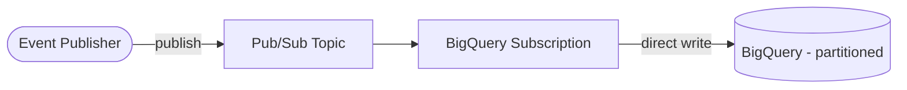

# Architecture Diagram — GCP Streaming Data Warehouse

## Lucid diagram

- **View:** https://lucid.app/lucidchart/d0a625bc-1af9-49ae-80ec-15ebe7bd8380/view
- **Edit:** https://lucid.app/lucidchart/d0a625bc-1af9-49ae-80ec-15ebe7bd8380/edit

## Lucid prompt (reusable)

```
Create a GCP data diagram titled "GCP Streaming Data Warehouse".
An Event Publisher publishes to a Pub/Sub Topic; a BigQuery Subscription writes the
messages directly into a partitioned BigQuery table (no Dataflow). Label the arrows.
Clean, professional Google Cloud colors.
```

## Mermaid source


